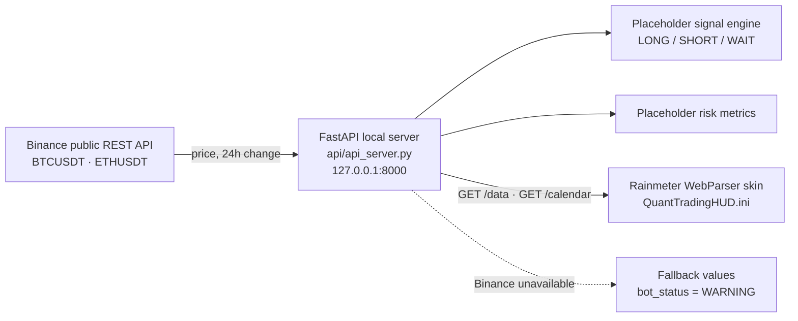

# quant-trading-rainmeter-hud

A Windows-friendly Rainmeter desktop HUD for quantitative trading monitoring.
It is powered by a local FastAPI server and Binance public market data.

This project is monitoring only. It does not place trades, does not connect to
your exchange account, and does not require exchange API keys.

## Architecture



The local API runs at:

```text
http://127.0.0.1:8000
```

## Screenshot

> **TODO (owner):** add a screenshot of the HUD running on a Windows desktop, e.g. `docs/hud-screenshot.png`, and embed it here. It hasn't been captured yet because Rainmeter only runs on Windows.

## Sample `/data` response (real run)

The server was started with `uvicorn api_server:app` and queried on 2026-10-30 at 19:04 (UTC+8). Prices and 24h changes are **live Binance public data** at that moment. `signal`/`confidence`/`regime` come from the **placeholder** rule in the Signal Logic section, and `exposure`, `drawdown` and `sharpe` are **placeholder** risk values, not real account metrics.

```json
{
  "btc_price": 77752.97,
  "btc_change": -3.08,
  "eth_price": 2247.69,
  "eth_change": -3.36,
  "signal": "SHORT",
  "confidence": 0.68,
  "regime": "Risk-Off",
  "bot_status": "RUNNING",
  "latency_ms": 2486,
  "exposure": 25.0,
  "drawdown": -2.2,
  "sharpe": 0.98,
  "date": "2026-10-30",
  "day": "Friday",
  "updated_at": "2026-10-30 19:04:19"
}
```

## Work with me

I build custom trading dashboards, bot monitoring and trading automation. **Upwork:** https://www.upwork.com/freelancers/~01f2d28a00fa4262d3

## Features

- FastAPI local server
- Binance public REST data for `BTCUSDT` and `ETHUSDT`
- Graceful fallback values if Binance is unavailable
- Placeholder signal engine: `LONG`, `SHORT`, or `WAIT`
- Placeholder risk metrics for desktop monitoring
- Rainmeter WebParser HUD skin
- Static trading operations calendar
- One-file Windows startup script

## Quick Start

1. Install Python from https://www.python.org/downloads/windows/
   - During setup, enable **Add python.exe to PATH**.
2. Install Rainmeter from https://www.rainmeter.net/
3. Double-click:

```text
api\start_api.bat
```

Keep this terminal window open while using the HUD.

4. Open this URL in your browser:

```text
http://127.0.0.1:8000/data
```

5. Copy this folder:

```text
rainmeter\QuantTradingHUD
```

to:

```text
Documents\Rainmeter\Skins
```

6. In Rainmeter, go to **Manage**, click **Refresh all**, then load:

```text
QuantTradingHUD.ini
```

## API Endpoints

### `GET /`

Health check.

### `GET /data`

Returns:

```json
{
  "btc_price": 0.0,
  "btc_change": 0.0,
  "eth_price": 0.0,
  "eth_change": 0.0,
  "signal": "WAIT",
  "confidence": 0.51,
  "regime": "Sideways",
  "bot_status": "RUNNING",
  "latency_ms": 0,
  "exposure": 0.0,
  "drawdown": 0.0,
  "sharpe": 0.0,
  "date": "2026-04-26",
  "day": "Sunday",
  "updated_at": "2026-04-26 12:00:00"
}
```

If Binance fails, the server returns numeric fallback values and sets
`bot_status` to `WARNING`.

### `GET /calendar`

Returns:

```json
{
  "date": "2026-04-26",
  "tasks": [
    {"time": "09:00", "name": "Risk Review"},
    {"time": "14:30", "name": "Backtest Batch"},
    {"time": "20:30", "name": "US Macro Watch"},
    {"time": "23:00", "name": "Execution Log Audit"}
  ]
}
```

## Signal Logic

The current signal logic is intentionally simple:

```text
BTC 24h change >= 1%   -> LONG,  confidence 0.72, regime Trending
BTC 24h change <= -1%  -> SHORT, confidence 0.68, regime Risk-Off
Otherwise              -> WAIT,  confidence 0.51, regime Sideways
```

This is a placeholder. Replace it with a real tested strategy engine before
using it for decision support.

## Project Structure

```text
quant-trading-rainmeter-hud/
|- api/
|  |- api_server.py
|  |- requirements.txt
|  `- start_api.bat
|- rainmeter/
|  `- QuantTradingHUD/
|     `- QuantTradingHUD.ini
|- docs/
|  |- setup.md
|  |- architecture.md
|  `- troubleshooting.md
|- README.md
|- AGENTS.md
`- .gitignore
```

## Documentation

- [Windows setup](docs/setup.md)
- [Architecture](docs/architecture.md)
- [Troubleshooting](docs/troubleshooting.md)

## Limitations

- No trading execution
- No exchange account data
- No private Binance API usage
- Placeholder signal logic only
- Placeholder risk metrics only
- Rainmeter must be refreshed if the API URL or port changes
